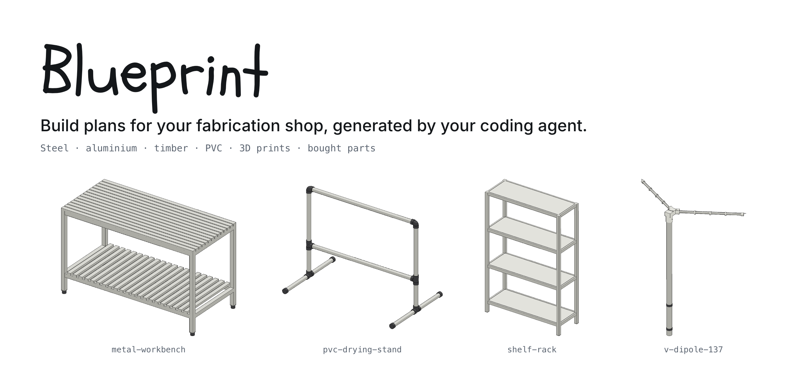
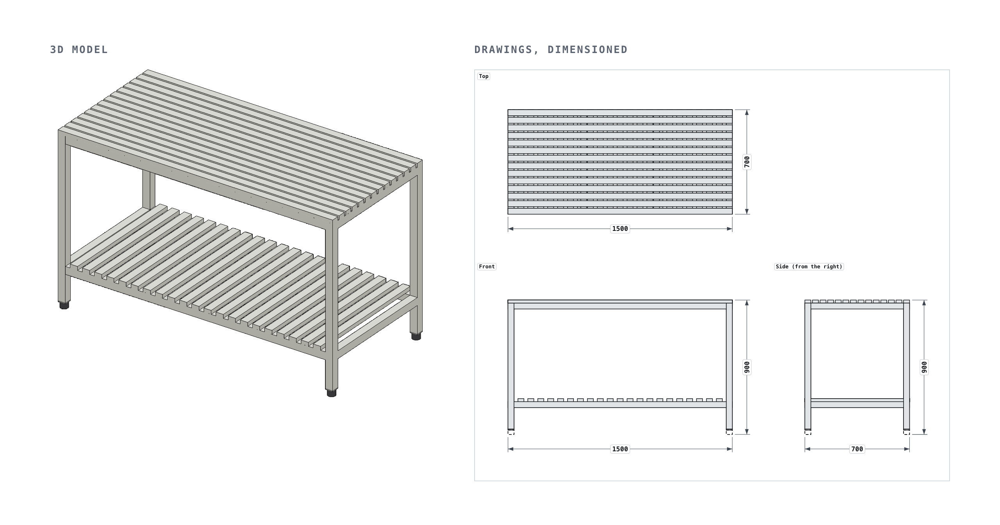
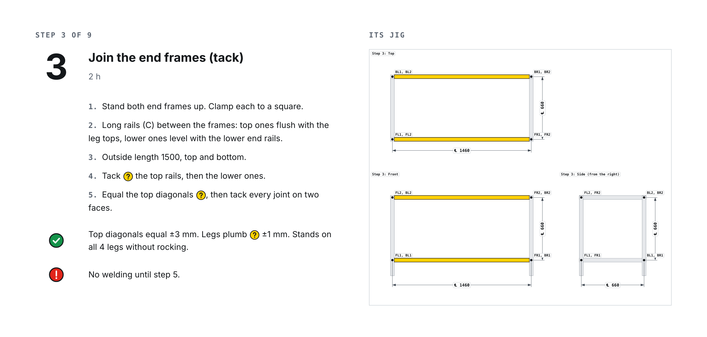
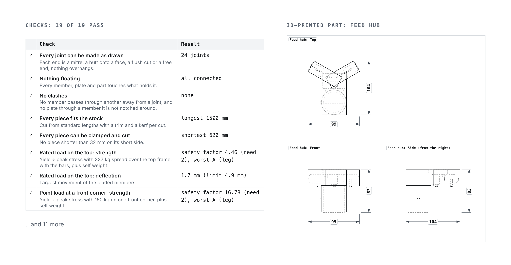
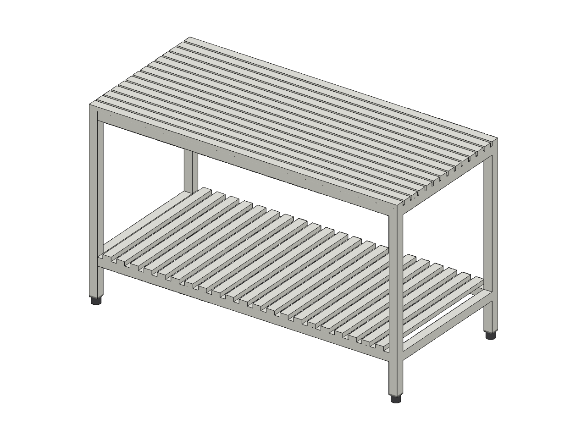
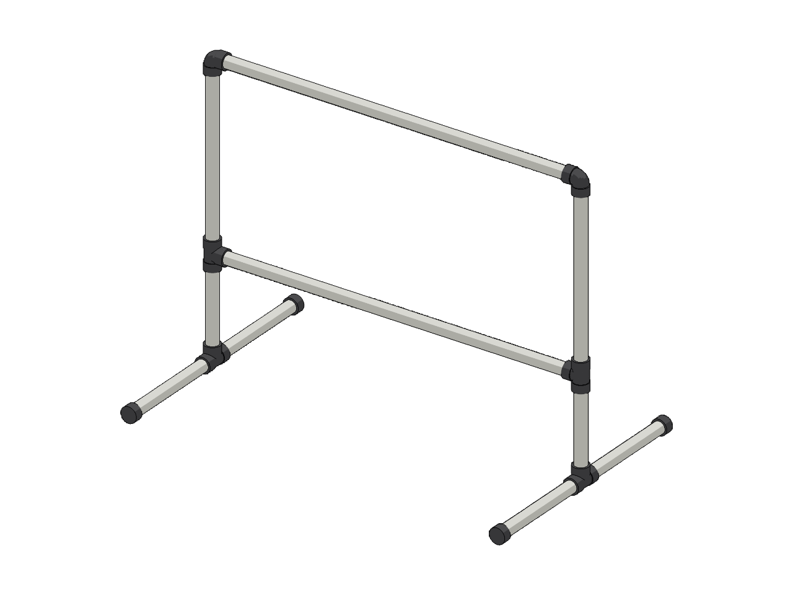
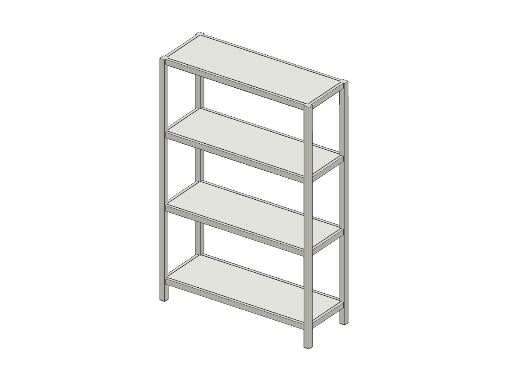
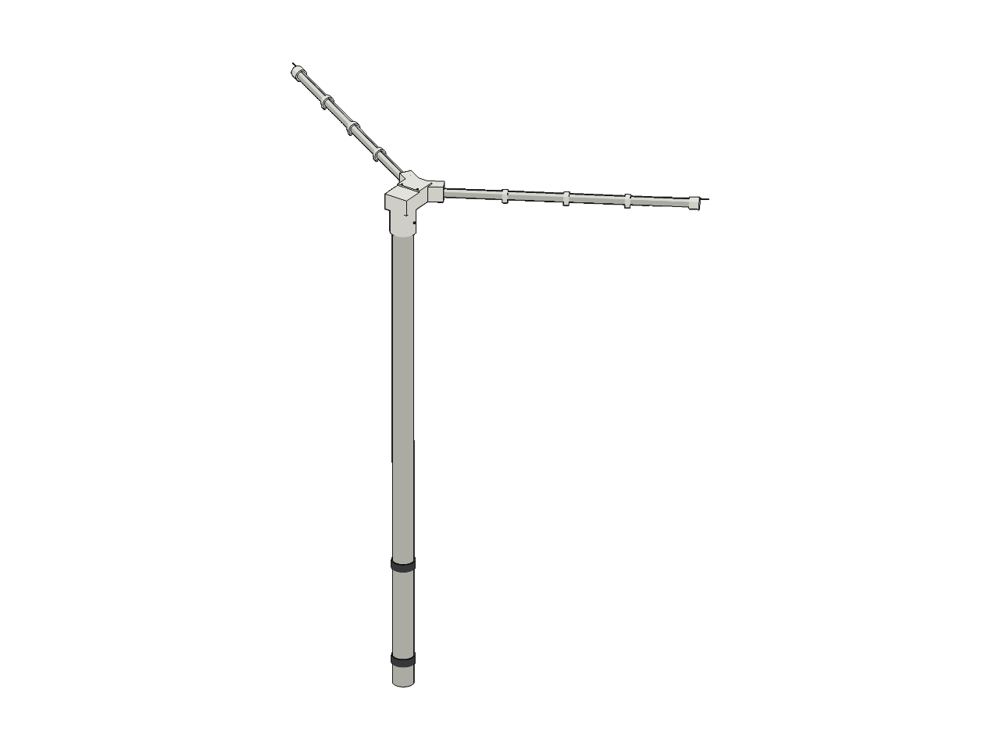

<p align="center"></p>

<p align="center">
  <a href="https://github.com/pham-tuan-binh/blueprint/actions/workflows/pages.yml"></a>
  <a href="LICENSE"></a>
  <a href="https://agentskills.io"></a>
  
  
  <a href="https://pham-tuan-binh.github.io/blueprint/"></a>
</p>

Blueprint is an agent skill that makes one HTML page per build plan with a 3D model, drawings, cut sheets and numbered steps. Change a size and everything follows. For metal, timber, PVC and 3D-printed parts.

[Browse the plans →](https://pham-tuan-binh.github.io/blueprint/)

<br>

<p align="center"><a href="https://pham-tuan-binh.github.io/blueprint/metal-workbench/"></a></p>

<br>

## 1. Install the skill

```bash
npx skills add pham-tuan-binh/blueprint
```

Works with Claude Code, Codex, Cursor, Gemini CLI and any agent that can run shell commands. Requires Node.js 20+ and Playwright with Chromium for browser checks.

## 2. Ask for a plan

> Create build plans for a simple metal workbench.

Include the sizes, materials and load it needs to carry. Metric is the default. Say inches if you want imperial.

## 3. Open the plan

Open `plans/<name>/index.html` in your browser. Adjust the sizes, switch between mm and inches, or print it for the shop.

Each plan includes:

- An interactive 3D model and dimensioned drawings.
- Materials to buy, a cutting plan and cut sheets.
- Numbered steps with jig drawings and checks.
- Checks for joints, clashes, stock fit, strength, sag and tip-over.
- STL and SCAD downloads for any 3D-printed parts.

The agent builds and audits the design, then checks the page in a browser before handing it over.

<br>

<p align="center"></p>

<br>

<p align="center"></p>

<br>

## 4. Share your plan

Ask your agent:

> Share my plan in plans/metal-workbench with the blueprint gallery.

The included `blueprint-share` skill checks the plan and prepares a pull request. It shows you what it will send before submitting. Each shared plan adds just one file: `plans/<id>/design.mjs`.

## Examples

Click one to open its build plan. Their sources are in [`skills/blueprint/examples/`](skills/blueprint/examples/).

<table>
<tr>
<td align="center" width="50%"><a href="https://pham-tuan-binh.github.io/blueprint/metal-workbench/"></a><br><a href="https://pham-tuan-binh.github.io/blueprint/metal-workbench/"><b>Welded steel workbench</b></a><br><sub>Steel frame, bar top and shelf.</sub></td>
<td align="center" width="50%"><a href="https://pham-tuan-binh.github.io/blueprint/pvc-drying-stand/"></a><br><a href="https://pham-tuan-binh.github.io/blueprint/pvc-drying-stand/"><b>PVC drying stand</b></a><br><sub>Pipe and solvent-weld fittings.</sub></td>
</tr>
<tr>
<td align="center" width="50%"><a href="https://pham-tuan-binh.github.io/blueprint/shelf-rack/"></a><br><a href="https://pham-tuan-binh.github.io/blueprint/shelf-rack/"><b>Steel shelf rack</b></a><br><sub>The smallest complete plan.</sub></td>
<td align="center" width="50%"><a href="https://pham-tuan-binh.github.io/blueprint/v-dipole-137/"></a><br><a href="https://pham-tuan-binh.github.io/blueprint/v-dipole-137/"><b>137 MHz V-dipole</b></a><br><sub>Copper wire, PVC arms and a printed feed hub.</sub></td>
</tr>
</table>

## Work with the source

Each plan lives in one `design.mjs`. The shared kit generates its model, drawings, checks and steps from that file.

From this repository's root:

```bash
# Check your tools
node skills/blueprint/scripts/blueprint.mjs doctor

# Start from an example
node skills/blueprint/scripts/blueprint.mjs new welding-cart --from metal-workbench

# Build, audit and check in a browser
node skills/blueprint/scripts/blueprint.mjs check plans/welding-cart/design.mjs
```

See the [skill instructions](skills/blueprint/SKILL.md), [design references](skills/blueprint/references/) and [example sources](skills/blueprint/examples/). Community plans live in [plans/](plans/).

To preview the site locally:

```bash
node tools/site.mjs
npx http-server _site
```

GitHub Actions publishes the examples and shared plans to GitHub Pages. The pictures in this README come from the examples too: `node tools/readme.mjs` redraws them into `.github/readme/` (it needs Playwright with Chromium).

## License

[MIT](LICENSE).
